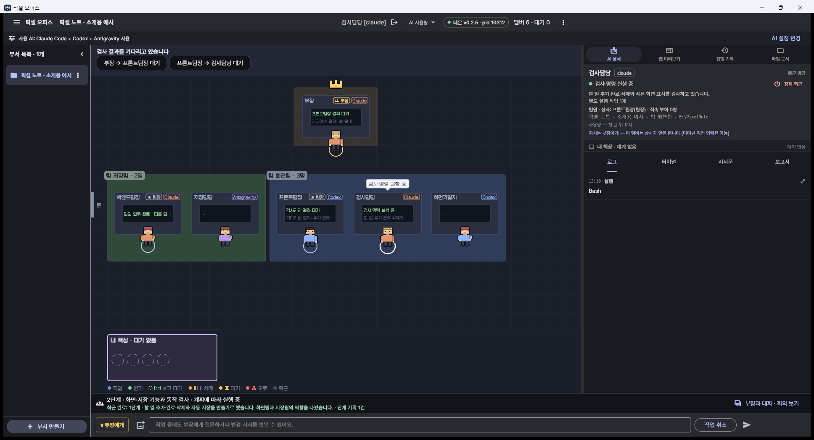
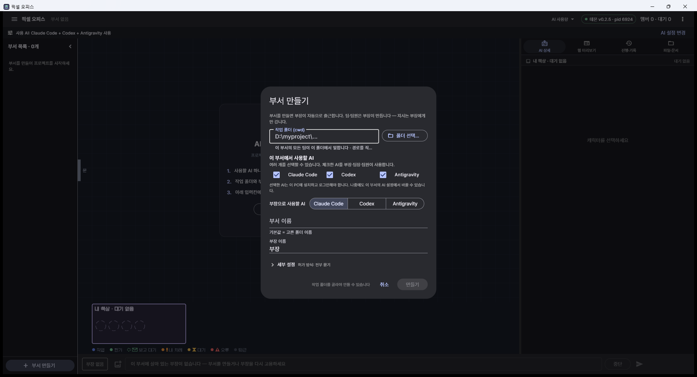
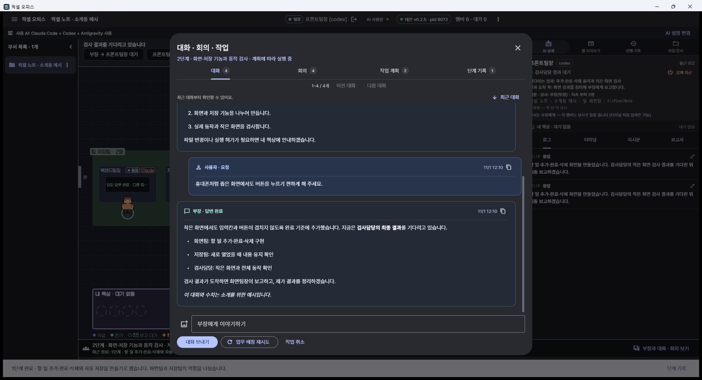
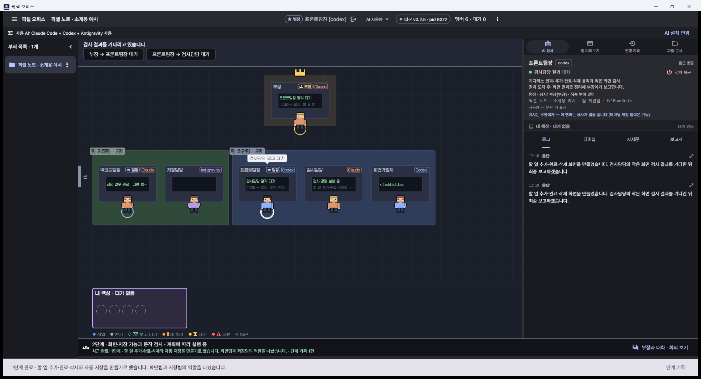
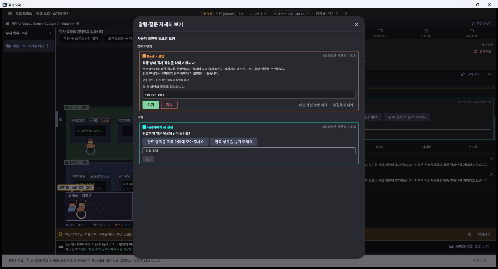
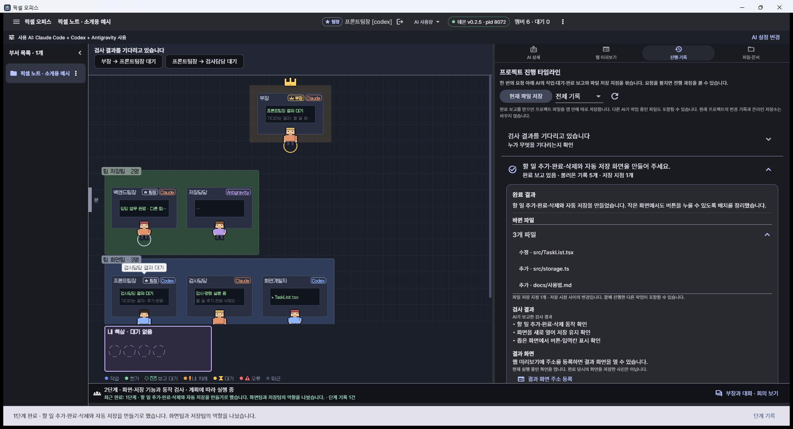
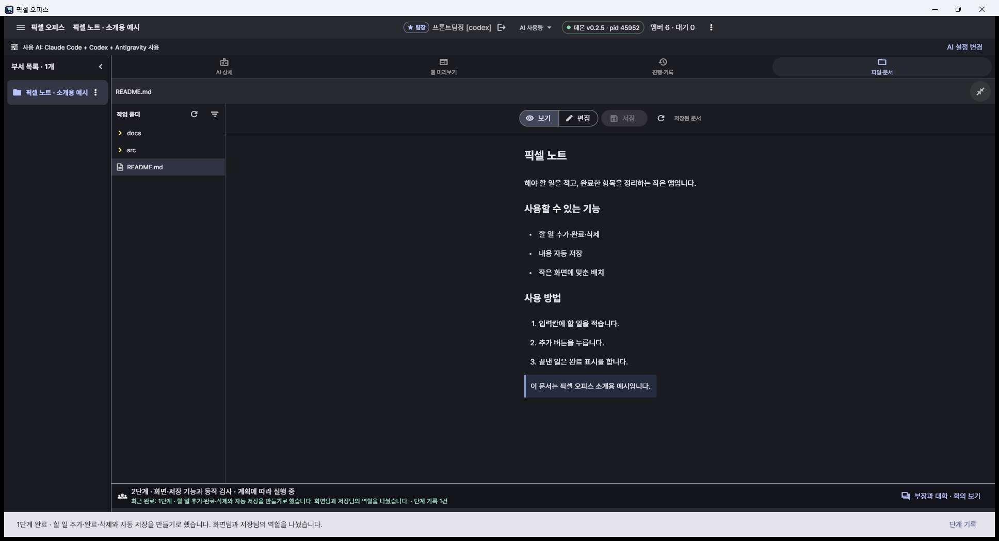
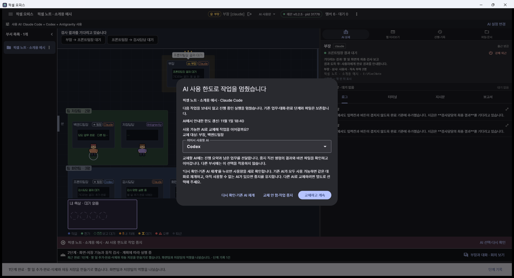

# 픽셀 오피스 · Pixel Office

**여러 AI에게 일을 나누고, 진행 상황과 결과를 픽셀 사무실에서 확인하세요.**

부장 AI에게 목표를 전달하면 팀을 구성하고 일을 나눕니다. 누가 작업하고 있는지, 누구의 결과를 기다리는지 살펴보고, 필요한 질문과 실행 허가는 **내 책상**에서 확인합니다.

**[Windows 0.2.5 다운로드](https://github.com/MaoEmong/pixel-office/releases/tag/v0.2.5)** · [사진으로 둘러보기](docs/screenshots/README.md) · [처음 사용 안내](docs/FIRST-USE-KO.md)

사진은 **현재 배포된 Windows 0.2.5 앱**을 촬영했습니다. 프로젝트·대화·검사 결과·사용량·로그인 상태는 소개용 예시이며 실제 AI의 작업 성과가 아닙니다. 사진을 누르면 크게 볼 수 있습니다.

## 처음 시작하기

현재는 **Windows 10·11의 64비트 PC용 시험판**입니다. 사용할 AI 프로그램의 설치와 계정 로그인은 별도로 필요하며, 이용 요금과 사용 한도는 각 서비스의 조건을 따릅니다.

1. [배포 페이지](https://github.com/MaoEmong/pixel-office/releases/tag/v0.2.5)에서 ZIP을 내려받아 **전체를 새 폴더에** 풉니다.
2. `pixel_office.exe`를 실행합니다. 실행 파일만 따로 옮기지 마세요.
3. 사용할 [Claude Code](https://code.claude.com/docs/en/setup)·[Codex](https://developers.openai.com/codex/cli/)·[Antigravity](https://antigravity.google/docs/cli/)를 준비하고 **준비 상태 확인**을 누릅니다. 사용할 AI만 설치하면 됩니다.
4. **부서 만들기**에서 작업 폴더와 사용할 AI를 고릅니다. 처음에는 허가 방식을 **전부 묻기**로 유지하세요.
5. 아래 입력칸으로 부장에게 작은 작업부터 맡겨 보세요.

> 이 폴더의 프로젝트를 살펴보고 구조와 사용 방법을 설명해줘. 파일은 아직 수정하지 마.

앱 실행에 필요한 구성품은 ZIP에 포함됩니다. **파일 저장 지점과 되돌리기**를 사용하려면 Git도 설치해야 합니다. Windows에서 제작자를 확인하는 서명은 아직 없으며, 다른 PC의 최초 설치·로그인도 검증하지 않았습니다. 중요한 작업은 복사본으로 먼저 사용해 보세요.

## 목표를 이야기하고 작업 계획을 확인하세요

부장과 대화하면서 원하는 결과와 완료 기준을 정합니다. 작업 중에도 질문하거나 방향을 바꿀 수 있습니다. **부장과 대화 · 회의 보기**에서 대화, 팀별 의견, 작업 계획과 완료한 단계 기록을 함께 볼 수 있습니다.

[회의 결정 보기](docs/screenshots/README.md#회의-결정과-팀별-의견) · [팀별 업무와 완료 기준 보기](docs/screenshots/README.md#팀별-업무와-완료-기준) · [완료 단계 기록 보기](docs/screenshots/README.md#완료한-단계와-다음-진행)

## 누가 어떤 결과를 기다리는지 확인하세요

사무실 위에서 담당자 사이의 대기 관계를 보고, 캐릭터를 누르면 **기다리는 결과와 결과 도착 후 할 일**을 확인합니다. 등록된 결과가 모두 도착하면 원래 담당자에게 재개 안내를 전달합니다. 질문·허가·사용 한도나 입력 상태에 따라 실제 재개는 기다릴 수 있습니다.

| 화면 표시 | 뜻 |
|---|---|
| 검사·명령 실행 중 | 별도로 실행한 작업이 남아 있습니다. 검사 통과를 뜻하지는 않습니다. |
| 결과 대기 | 다른 담당자의 결과를 기다립니다. 상세 화면에서 상대와 필요한 결과를 확인하세요. |
| 미완료 업무 있음 | 완료 보고가 남아 있습니다. 실제 명령이 실행 중인지는 별도로 확인해야 합니다. |
| 지시 접수 확인 필요 | AI가 지시를 받았는지 아직 확인되지 않았습니다. 최근 기록과 터미널을 확인하세요. |

## 질문과 실행 허가는 내 책상에서 결정하세요

사용자에게 온 질문과 실행 허가 요청을 한곳에서 확인합니다. **크게 보기**를 열면 요청한 담당자, 작업 설명과 실제 실행 내용을 읽을 수 있습니다. AI끼리 주고받는 질문은 상사의 답변 대기로 구분합니다.

처음에는 기본 허가 방식을 사용하세요. **모든 권한 허용**을 켜면 삭제·설치·온라인 전송도 자동 허가합니다. 키를 AI에게 전달하면 AI 서비스와 대화 기록에 포함될 수 있습니다. [키·권한 안내](docs/KEYS-AND-PERMISSIONS-KO.md)

## 바뀐 파일과 보고된 검사 결과를 함께 보세요

**진행·기록**에서 요청 하나를 펼치면 작업 과정과 완료 보고, 바뀐 파일과 파일 저장 지점을 확인할 수 있습니다. 검사 결과는 AI가 보고한 내용이며, 실행 기록만으로 통과했다고 표시하지 않습니다.

파일 저장 지점은 PC 안에 따로 보관하며 원래 프로젝트의 변경 기록이나 온라인 저장소를 바꾸지 않습니다. 되돌릴 때는 복원할 파일을 먼저 확인합니다. **대화·외부 데이터베이스·웹사이트·온라인 전송까지 과거로 돌아가지는 않습니다.** [저장·복구 범위](docs/PROJECT-TIMELINE-KO.md)

## 프로젝트 문서를 앱 안에서 읽고 수정하세요

**파일·문서**에서 폴더를 펼쳐 문서를 선택합니다. **보기 / 편집**으로 전환하고, **문서 넓게 보기**로 읽기 영역을 늘릴 수 있습니다. Markdown(.md)·텍스트(.txt) 문서를 지원합니다.

AI가 같은 문서를 바꾸면 작성 중인 글을 유지하고 변경 내용을 비교하도록 안내합니다. 저장하지 않은 글은 앱을 완전히 닫기 전에 저장하세요. [문서 확대·편집 화면 보기](docs/screenshots/README.md#문서를-넓게-읽고-편집하기)

## AI 사용량과 재개 방법을 확인하세요

상단 **AI 사용량**에서 서비스별 사용량과 마지막 확인 시각을 봅니다. 확인할 수 없는 수치는 미확인으로 표시합니다. Antigravity 안의 모델별 사용량은 별도 Claude Code·Codex 계정의 사용량과 다릅니다.

사용 한도가 소진되면 해당 부서의 실행을 멈추고 기존 업무·대화·완료 단계와 파일을 보존합니다.

- **다시 확인·기존 AI 재개**: 사용량을 새로 확인하고, 기존 구성의 AI가 모두 사용 가능하면 같은 AI·대화로 이어갑니다.
- **교체하고 계속**: 사용 가능한 다른 AI를 직접 고른 뒤 작업을 이어갑니다. 기존 대화는 남고 새 AI에 진행 요약과 남은 업무를 전달합니다.

한도 갱신 시각이 지났더라도 실제 사용 가능 여부를 다시 확인해야 합니다. AI 선택 목록을 열거나 항목을 고르는 것만으로는 재개하지 않습니다. [사용량·AI 선택 화면 보기](docs/screenshots/README.md#ai-사용량과-한도-안내)

## 함께 사용할 수 있는 기능

| 하고 싶은 일 | 안내 |
|---|---|
| 여러 프로젝트 관리 | 작업 폴더마다 부서를 만들고 왼쪽 목록에서 전환합니다. |
| 작업 결과 화면 확인 | **웹 미리보기**에 실행 중인 웹페이지 주소를 등록합니다. Windows에서는 Microsoft Edge WebView2 Runtime이 필요합니다. |
| 휴대폰에서 확인·조작 | 작업 PC를 켜 둔 채 별도 연결 설정과 기기 승인을 거쳐 브라우저로 접속합니다. [원격 접속 안내](docs/원격접속.md) |
| 담당자의 작업 원칙 확인 | 캐릭터를 선택한 뒤 **AI 상세 → 지시문**에서 역할과 작업 원칙을 봅니다. |

[최신 화면 22장 자세히 보기](docs/screenshots/README.md)

## 기록 보관과 업데이트

기록을 보관하는 위치는 다음과 같습니다. 백업할 때는 두 위치를 함께 보관하세요.

- **앱 설정·조직·키·파일 저장 기록:** `%LOCALAPPDATA%\pixel-office`
- **프로젝트별 AI 대화·작업 파일:** 선택한 프로젝트의 `.pixel-office`

업데이트할 때는 진행 중인 검사·명령이 끝난 뒤 새 작업을 잠시 보류하세요. 작성 중인 글을 저장하고 앱을 정상 종료한 다음, 위 폴더를 백업합니다. 새 ZIP 전체를 **새 폴더**에 풀어 실행하고 기존 대화·미완료 업무를 확인한 뒤 작업을 이어가세요.

재실행 시 저장된 작업의 복구를 시도합니다. 로그인 만료·권한 문제나 실행 중이던 명령의 결과는 추가 확인이 필요할 수 있습니다. [자세한 설치·업데이트 안내](docs/release/0.2.5/README-KO.md)

## 0.2.5에서 달라진 점

- 부장과 담당자의 답변이 대화·보고에서 빠지는 상황을 보완했습니다.
- Windows에서 Codex에 한글·기호가 포함된 지시를 전달하고 접수 여부를 확인하는 동작을 보완했습니다.
- 기다리는 담당자와 결과, 다음 할 일을 표시하고 결과 도착 후 재개를 안내합니다. 대기 중인 업무가 완료로 잘못 바뀌지 않도록 보완했습니다.

[전체 변경 내역](docs/release/0.2.5/RELEASE-NOTES.md)

## 도움이 필요하면

[처음 사용 안내](docs/FIRST-USE-KO.md) · [문제 해결](docs/환경-문제해결.md) · [설치·업데이트](docs/release/0.2.5/README-KO.md)

[GitHub 이슈](https://github.com/MaoEmong/pixel-office/issues)에 **앱 버전, 사용 AI, 오류 문구와 문제가 생긴 순서**를 남겨 주세요. 인증 파일·키·비밀번호와 비공개 프로젝트 내용은 첨부하지 마세요.

macOS·Linux용 배포 파일은 현재 제공하지 않습니다. 제작: MaoEmong.
