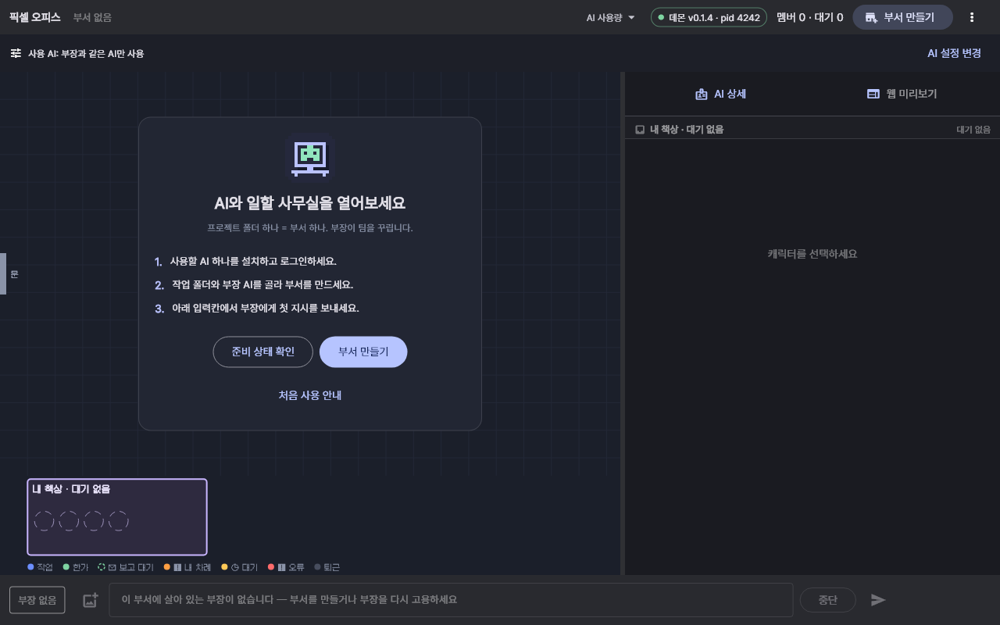
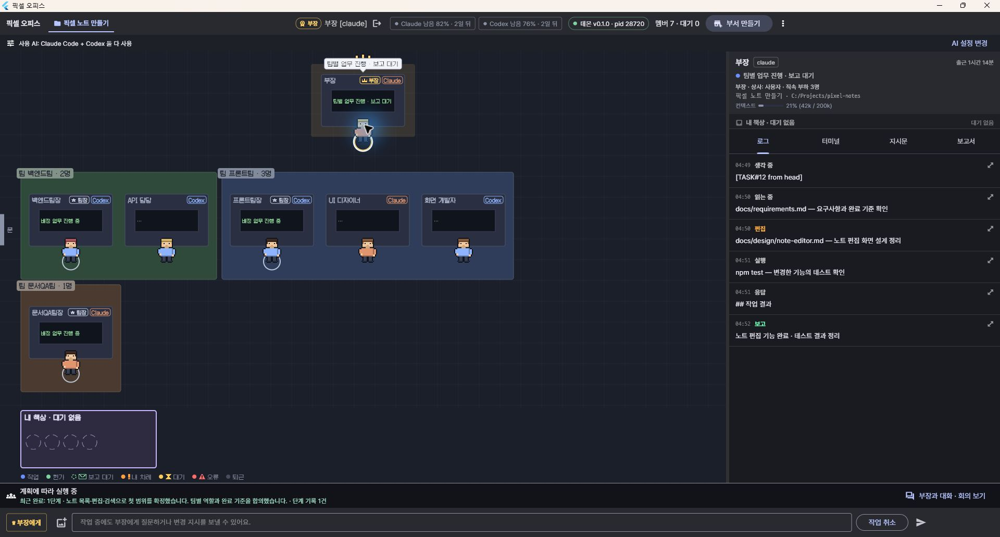

# 픽셀 오피스 · Pixel Office

**Claude Code·Codex·Antigravity의 작업을 픽셀 사무실에서 확인하는 Windows 앱입니다.**

부장 AI에게 목표를 이야기하면 AI가 팀을 구성하고 일을 나눕니다. 캐릭터를 눌러 대화와 작업을 보고, 사용자가 판단할 질문과 실행 허가는 **내 책상**에서 확인합니다.

[Windows 0.2.1 다운로드](https://github.com/MaoEmong/pixel-office/releases/tag/v0.2.1) · [처음 사용 안내](docs/FIRST-USE-KO.md) · [설치·업데이트](docs/release/0.2.1/README-KO.md) · [검증 범위](docs/release/0.2.1/VERIFICATION.md)

## 사용 전에 확인하세요

- 현재 배포 파일은 **Windows x64 시험판**입니다. macOS·Linux용 파일은 제공하지 않습니다.
- 사용할 AI 프로그램의 **설치와 계정 로그인은 별도**입니다. 사용할 AI만 준비하면 됩니다. 계정·요금·사용 한도는 각 서비스의 조건을 따릅니다.
- Node.js와 앱 실행 구성품은 ZIP에 포함됩니다. Flutter·Visual Studio·npm은 앱 사용에 필요하지 않습니다. **파일 저장 지점과 되돌리기는 Git 설치가 필요합니다.**
- Windows 코드 서명과 다른 PC의 최초 설치·로그인 검증은 아직 하지 않았습니다. 보안 설정에 따라 경고나 실행 제한이 있을 수 있습니다. 연습용 폴더나 복사본으로 먼저 사용하세요.

## 처음 시작하기

1. [배포 페이지](https://github.com/MaoEmong/pixel-office/releases/tag/v0.2.1)에서 ZIP을 내려받아 **전체**를 새 폴더에 풉니다.
2. `pixel_office.exe`를 실행합니다. 실행 파일만 따로 옮기지 마세요.
3. 사용할 AI를 설치하고 로그인한 뒤 **준비 상태 확인**을 누릅니다.
4. **부서 만들기**에서 작업 폴더, 부장 AI와 팀에서 사용할 AI를 고릅니다. 처음에는 기본 허가 방식을 유지하세요.
5. 아래 입력칸에 작은 작업부터 지시합니다. 예: “이 프로젝트의 구조와 실행 방법을 설명해줘. 아직 파일은 수정하지 마.”

위 이미지는 0.1.4 앱에 검사 전용 연결 정보를 넣어 촬영한 안내 예시입니다. 실제 AI 작업이나 실제 계정의 결과를 보여주지 않으며, 현재 화면 배치는 다를 수 있습니다.

## 할 수 있는 일

| 하고 싶은 일 | 앱에서 하는 방법 |
|---|---|
| 여러 프로젝트 관리 | 왼쪽 부서 목록에서 작업 폴더를 고릅니다. 각 부서에 부장과 팀이 배치됩니다. |
| 목표 전달·방향 변경 | 부장과 목표·완료 기준을 정하고 작업 중에도 질문이나 변경 지시를 보냅니다. |
| 진행 과정·결과 확인 | **진행·기록**에서 요청별 타임라인과 완료 결과를 봅니다. 바뀐 파일과 보고된 검사 결과를 함께 표시합니다. |
| 문서 읽고 수정 | **파일·문서**에서 폴더를 펼치고 Markdown·텍스트 문서를 읽거나 편집합니다. 동시 변경 시 저장 충돌을 안내합니다. |
| 파일 저장·되돌리기 | 별도의 로컬 기록에 저장하고, 복원할 파일을 확인한 뒤 되돌립니다. 원래 프로젝트의 Git 커밋은 바꾸지 않습니다. |
| 실행 허가 판단 | **내 책상**에서 작업 설명·영향·실제 명령을 읽고 허가하거나 거부합니다. |
| AI 한도·연결 문제 대응 | 한도 소진 시 중지하고 확인 후 다른 AI로 교체합니다. 멈춘 AI는 영향 범위를 확인한 뒤 강제 퇴근시킬 수 있습니다. |
| 사용량 확인 | **AI 사용량**에 마우스를 올려 요약을 보거나 눌러 상세 정보를 엽니다. 확인하지 못한 수치는 미확인으로 표시합니다. |
| 키·허가 방식 설정 | 프로젝트별 키 저장소와 경고 확인을 거치는 모든 권한 허용 설정을 제공합니다. [키·권한 안내](docs/KEYS-AND-PERMISSIONS-KO.md)를 먼저 읽으세요. |

**파일 되돌리기는 외부 데이터베이스·웹사이트·온라인 전송이나 대화를 과거로 되돌리지 않습니다.** [저장·복구 범위](docs/PROJECT-TIMELINE-KO.md)를 확인하세요. 키를 AI에게 전달하면 해당 서비스와 CLI 기록에 포함될 수 있고, 모든 권한 허용에는 삭제·설치·외부 전송도 포함됩니다.

Antigravity의 내부 모델 그룹 사용량은 별도 Claude Code·Codex 계정의 사용량과 다릅니다. 잔여량 표시가 모든 요금제에서 해당 모델을 사용할 수 있다는 뜻은 아닙니다.

[기존 스크린샷](docs/screenshots/README.md)은 실제 앱에 소개용 데이터를 넣은 예시입니다. 실제 작업 성과나 계정 정보를 보여주지 않으며 이전 화면이 포함되어 있습니다.

## 0.2.1에서 바뀐 점

- PC·모바일에서 검사·명령 실행 중 표시와 상대·업무별 결과 대기 관계를 확인합니다.
- 대화 100개 이후에도 이어 가며, 긴 과거 대화는 나누어 읽고 새 메시지만 추가 저장합니다.
- 입력 복구, 대기 지시와 완료 보고 전달, 미완료 업무의 조기 완료 방지를 보완했습니다.
- 대기 목록 마우스 드래그와 부서 이름 변경을 제공합니다.
- 닫힌 터미널 출력 연결 처리, 과거 대화의 등록된 키 가림과 요청 재시도 호환성을 보완했습니다.

[전체 변경 내역](docs/release/0.2.1/RELEASE-NOTES.md) · [실제 검사 범위와 제한](docs/release/0.2.1/VERIFICATION.md)

## 저장·업데이트·문제 제보

앱 설정·조직·키와 프로젝트 기록은 PC의 앱 데이터 폴더에, 프로젝트별 대화와 작업 기록은 선택한 폴더의 `.pixel-office`에 보관합니다. 재실행 시 저장된 작업의 복구를 시도하지만 로그인 만료·권한 문제는 사용자의 조치가 필요할 수 있습니다.

업데이트 전에는 작업을 마치고 앱을 정상 종료한 뒤 두 데이터 폴더를 백업하세요. 새 ZIP은 기존 설치 폴더에 덮어쓰지 말고 **새 폴더**에 풉니다. [설치·업데이트 안내](docs/release/0.2.1/README-KO.md)

[GitHub 이슈](https://github.com/MaoEmong/pixel-office/issues)에 앱 버전·사용 AI·오류 문구·재현 순서를 남겨주세요. 계정 정보·인증 파일·키·비밀번호·비공개 프로젝트 내용은 공개하지 마세요.

[문제 해결](docs/환경-문제해결.md) · [선택 기능: 원격 접속](docs/원격접속.md)

이 저장소는 앱 소개·다운로드·사용 안내용입니다. ZIP에는 실행용 코드와 필요한 외부 구성품이 포함됩니다. 제작: MaoEmong.
