# 픽셀 오피스 화면으로 둘러보기

[프로젝트 소개](../../README.md) · [Windows 0.2.5 다운로드](https://github.com/MaoEmong/pixel-office/releases/tag/v0.2.5) · [처음 사용 안내](../FIRST-USE-KO.md)

**현재 배포된 Windows 0.2.5 앱의 화면 22장**입니다. 2026년 11월 1일에 새로 촬영했습니다. 사진을 누르면 크게 볼 수 있습니다.

모든 사진은 개인 작업과 분리한 소개용 환경에서 촬영했습니다. 프로젝트·대화·회의·작업 결과·사용량·로그인 상태는 예시입니다. 실제 AI의 작업 성과나 검사 통과를 증명하는 사진은 아닙니다. **마우스 커서 없이 앱 창을 직접 촬영했으며 화면을 다시 그리거나 합성하지 않았습니다.**

[처음 시작하기](#처음-시작하기) · [사무실과 작업 상태](#사무실과-작업-상태) · [대화·회의·계획](#대화회의계획) · [진행·결과](#진행결과) · [문서](#프로젝트-문서) · [질문·허가](#질문과-실행-허가) · [AI 사용량·한도](#ai-사용량과-한도-안내)

## 처음 시작하기

### 01 · 첫 실행

사용할 AI를 준비하고, 작업할 폴더를 부서로 만드는 순서를 안내합니다. **준비 상태 확인**과 **처음 사용 안내**도 여기에서 열 수 있습니다.

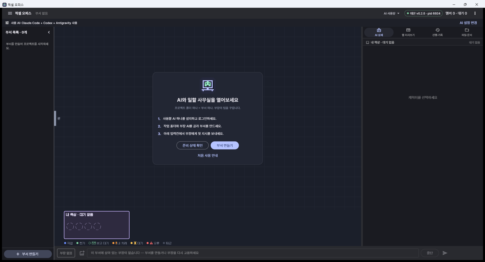

### 02 · 부서 만들기

작업 폴더와 부장 AI, 팀에서 사용할 AI를 고릅니다. 한 가지 AI만 사용하거나 여러 AI를 함께 사용할 수 있습니다. 처음에는 허가 방식을 **전부 묻기**로 유지하세요.

## 사무실과 작업 상태

### 03 · 전체 팀 구성

왼쪽에서 프로젝트를 선택하고, 사무실에서 부장·팀장·팀원이 맡은 일을 살펴봅니다. 아래 입력칸으로 부장에게 질문과 변경 지시를 보냅니다.

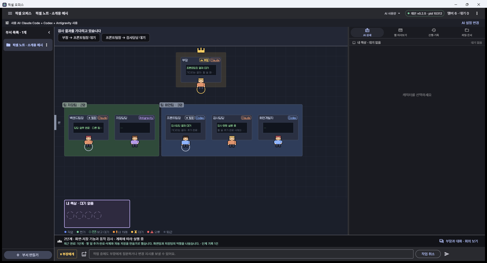

### 04 · 누가 어떤 결과를 기다리는지

위쪽에 **부장 → 프론트팀장**, **프론트팀장 → 검사담당**처럼 대기 관계가 표시됩니다. 캐릭터를 누르면 필요한 결과와 결과 도착 후 할 일을 읽을 수 있습니다.

### 21 · 실행과 결과 대기 구분

**검사·명령 실행 중**은 별도 실행 작업이 남아 있다는 표시입니다. 다른 담당자의 결과 대기나 미완료 업무와 구분해서 확인하세요. 이 사진의 실행 상태는 소개용 예시입니다.

### 22 · 담당자의 역할과 작업 원칙

캐릭터를 선택하고 **지시문**을 열면 담당자의 역할과 작업 원칙을 볼 수 있습니다. 내용을 바꿀 때는 저장 후 언제 적용할지 구분해서 선택합니다. 실행 중인 작업을 다시 시작하는 선택은 영향을 확인한 뒤 사용하세요.

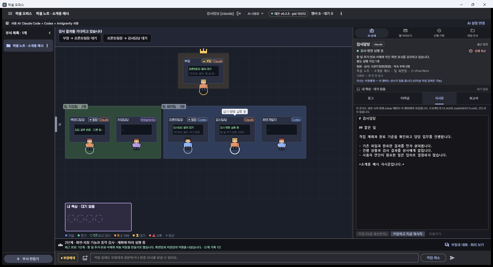

## 대화·회의·계획

### 05 · 부장과 대화

**부장과 대화 · 회의 보기**에서 사용자 요청과 부장 답변을 구분해 읽습니다. 작업 중에도 질문하거나 원하는 결과를 추가할 수 있습니다.

### 회의 결정과 팀별 의견

**회의** 탭에서 부장이 확정한 범위와 팀장별 의견을 확인합니다. 회차를 펼치면 처음 제안과 이후 조율 내용을 읽을 수 있습니다.

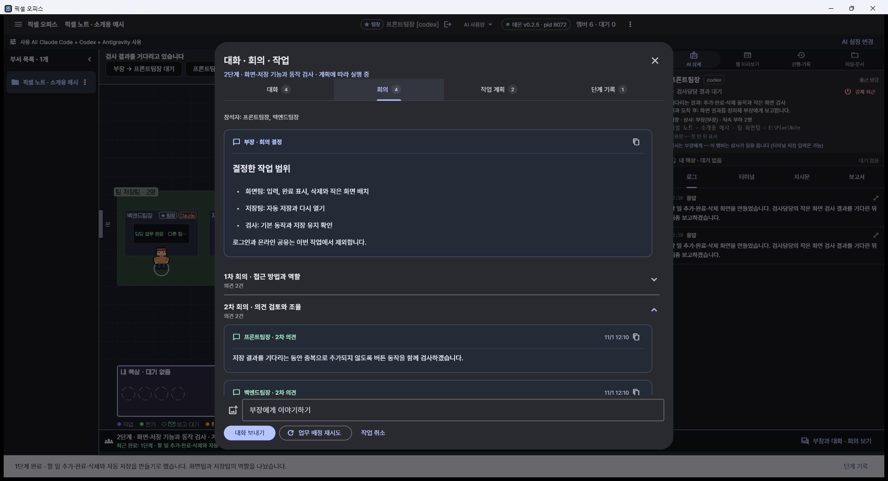

### 팀별 업무와 완료 기준

**작업 계획** 탭에서 누가 어떤 일을 맡았고 무엇을 확인해야 완료하는지 살펴봅니다. 선행 담당자가 있으면 함께 표시합니다.

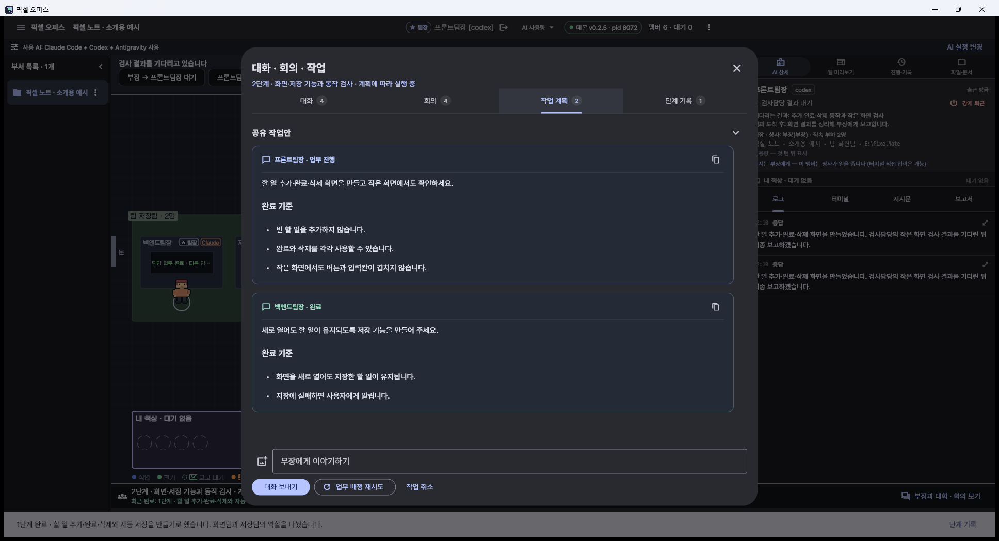

### 완료한 단계와 다음 진행

**단계 기록**에 완료 내용, 보고된 검증 결과와 다음 진행이 남습니다. 한 단계의 완료와 전체 작업의 완료는 구분됩니다.

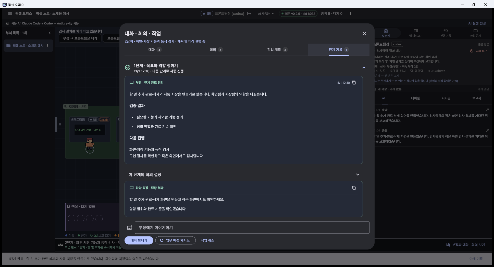

## 진행·결과

### 09 · 요청별 진행 기록

오른쪽 **진행·기록**에서 요청별 작업·대기·완료 보고와 저장 지점을 봅니다. 요청을 펼치면 관련 기록을 이어서 확인할 수 있습니다.

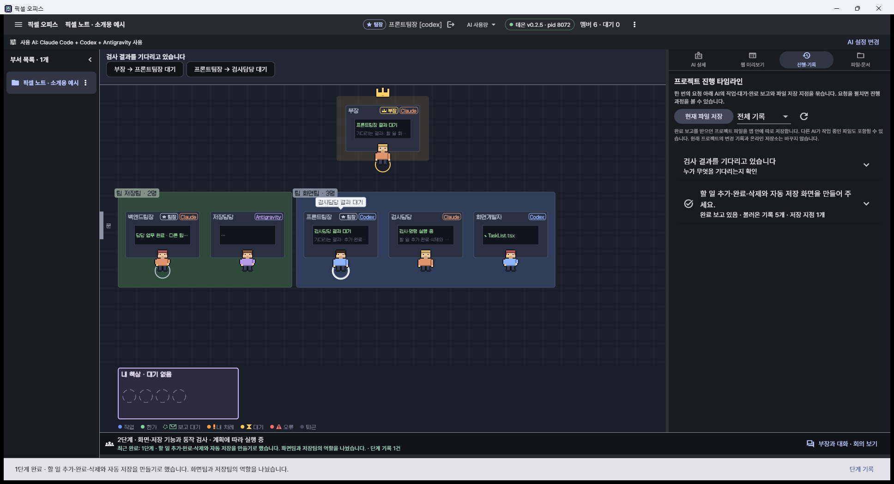

### 10 · 완료 결과와 바뀐 파일

완료 보고와 변경된 파일 목록, AI가 보고한 검사 결과가 모입니다. 검사 실행 기록만 있으면 통과했다고 표시하지 않습니다. **결과 화면**은 등록된 웹 미리보기를 열며 완료 당시의 사진을 보관하는 기능은 아닙니다.

## 프로젝트 문서

### 11 · 폴더 목록에서 문서 고르기

**파일·문서**에서 폴더를 펼치고 문서를 고릅니다. Markdown·텍스트 문서를 앱 안에서 읽고 수정할 수 있습니다.

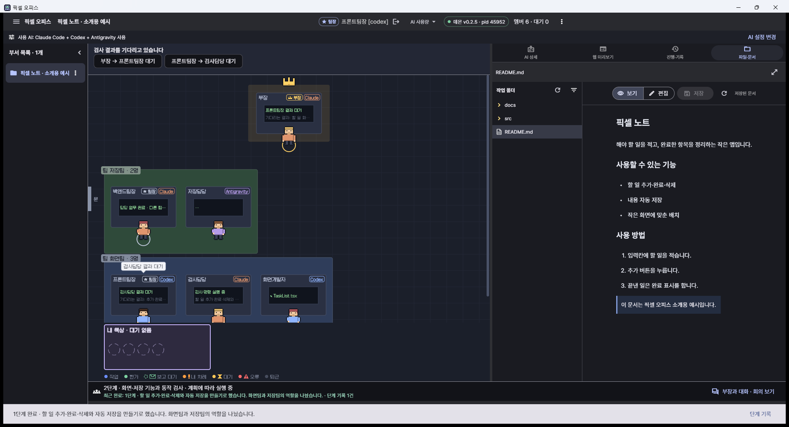

### 문서를 넓게 읽고 편집하기

**문서 넓게 보기**로 사무실 영역까지 읽기 공간을 늘릴 수 있습니다.

### 13 · 문서 편집

**편집**을 누르면 문서 내용을 수정하고 저장할 수 있습니다. AI가 같은 파일을 바꾸면 최신 내용과 비교하도록 안내합니다. 작성 중인 글은 앱을 닫기 전에 저장하세요.

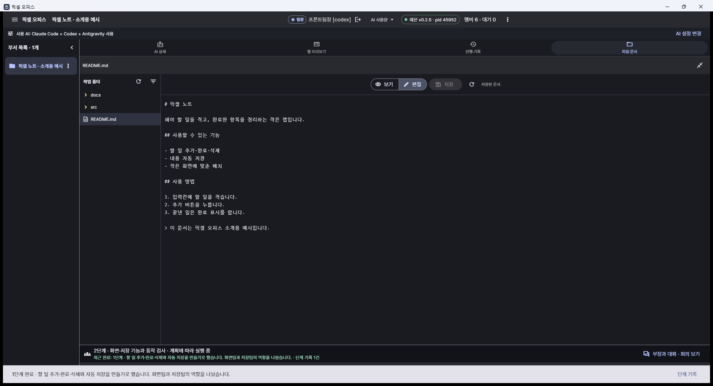

## 질문과 실행 허가

### 14 · 확인할 항목 모아 보기

**확인 대기 → 확인하기**에서 사용자가 답하거나 허가해야 할 항목을 모아 봅니다. 항목을 누르면 해당 화면으로 이동합니다.

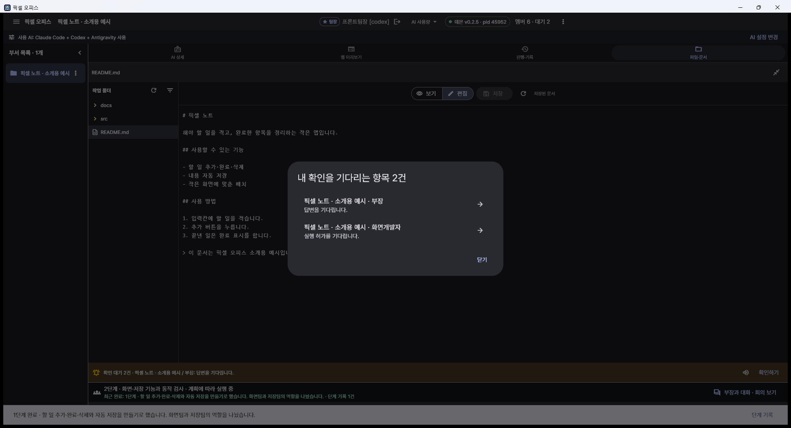

### 15 · 사용자에게 온 질문

질문을 읽고 선택지나 직접 입력으로 답할 수 있습니다. 선택지를 누르면 바로 답변이 전송되는 질문도 있으므로 내용을 먼저 확인하세요.

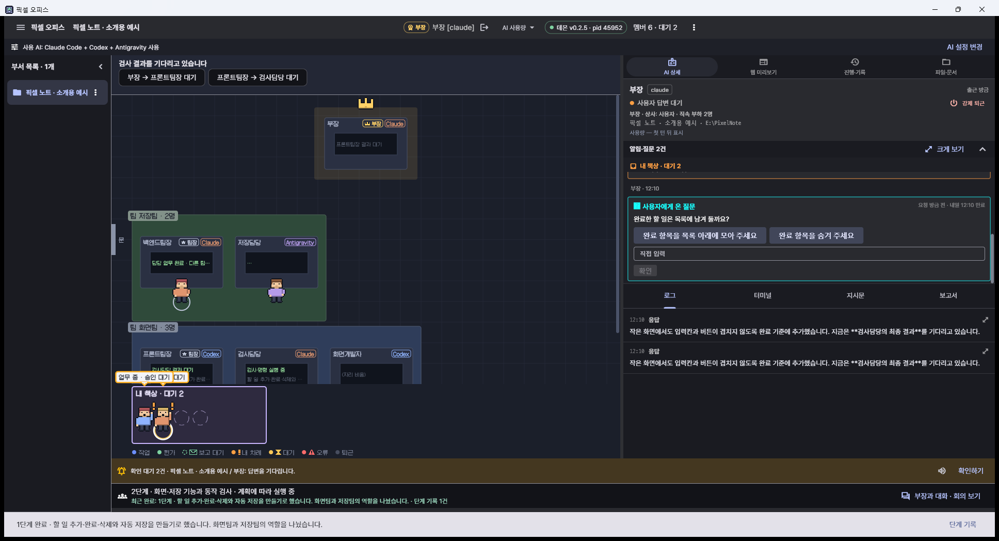

### 16 · 실행 내용을 읽고 결정하기

**크게 보기**에서는 요청한 담당자, 작업 설명과 실제 실행 내용을 함께 읽습니다. 허가와 거부는 사용자가 판단합니다. **이번 세션 항상 허가**와 **수정해서 허가**도 일반 허가와 구분해 선택하세요.

## AI 사용량과 한도 안내

### 17 · 서비스별 사용량

상단 **AI 사용량**을 누르면 남은 사용량과 갱신 시각, 마지막 확인 시각을 봅니다. 확인할 수 없는 수치는 미확인으로 표시합니다. 사진의 수치와 요금제는 예시입니다.

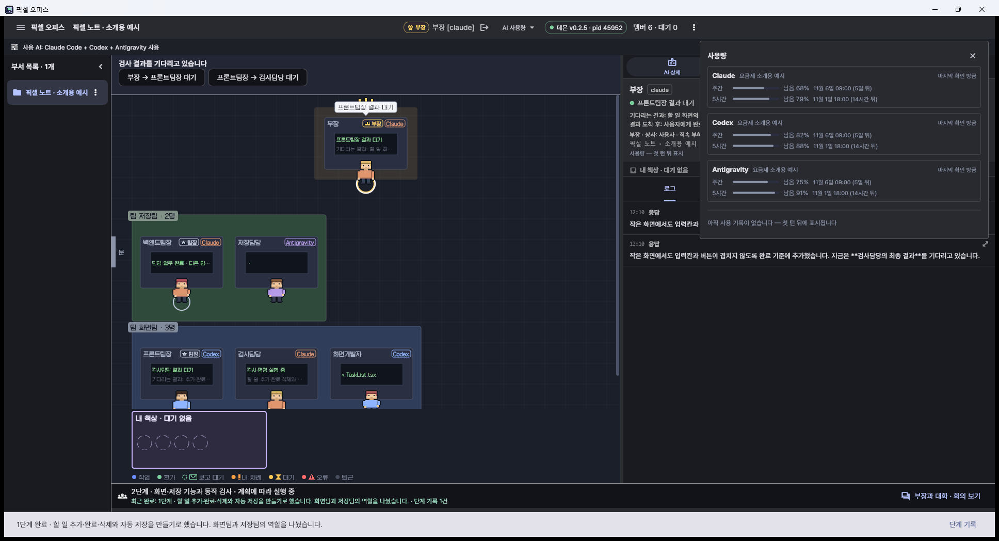

### 18 · 사용할 AI와 준비 상태

**AI 설정 변경**에서 부서가 사용할 AI를 고르고 설치·로그인 상태를 확인합니다. 이 화면의 연결 상태는 소개용 예시입니다. 실제 사용 전에는 자신의 PC에서 **다시 검사**를 눌러 확인하세요.

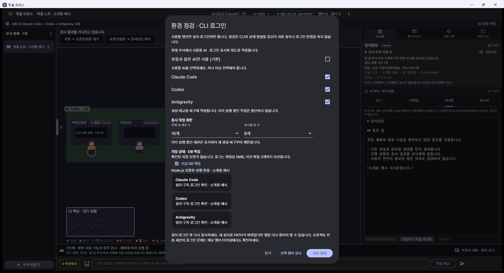

### 19 · 같은 AI로 재개하거나 다른 AI 선택

한도가 소진되면 기존 업무와 대화·완료 단계·파일을 보존하고 중지합니다. **다시 확인·기존 AI 재개**는 기존 AI의 사용 가능 여부를 새로 확인합니다. 일부 AI가 아직 사용할 수 없으면 중지를 유지합니다.

### 20 · 선택한 AI를 확인하고 교체

현재 선택한 AI에는 체크와 **선택됨** 표시가 있습니다. 목록에서 고르는 것만으로는 교체하지 않으며 **교체하고 계속**을 눌러야 진행합니다. 새 AI에는 진행 요약과 남은 업무를 전달합니다.

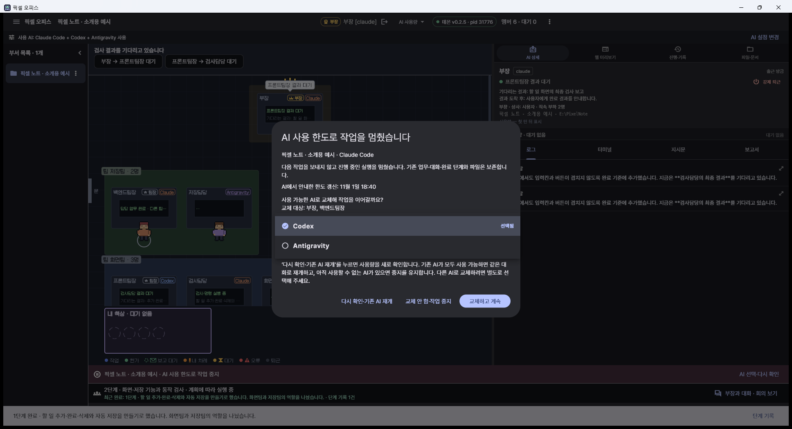

---

[처음 사용 안내](../FIRST-USE-KO.md) · [설치·업데이트](../release/0.2.5/README-KO.md) · [문제 해결](../환경-문제해결.md) · [저장·복구 범위](../PROJECT-TIMELINE-KO.md) · [키·권한 안내](../KEYS-AND-PERMISSIONS-KO.md) · [프로젝트 소개로 돌아가기](../../README.md)
